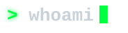
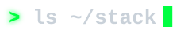
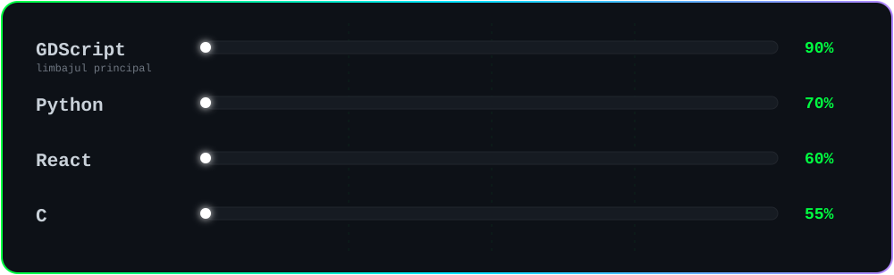
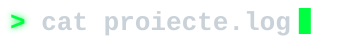
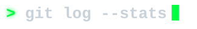
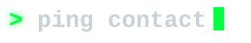
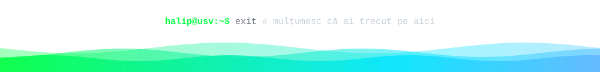

<!-- ═══════════════════════════════════════════════════════════
     README de profil GitHub — Halip Daniel (@kingptvoi)
     Folderul `assets/` conține animațiile SVG (trebuie urcat împreună cu README-ul)
     Caută "TODO" pentru lucrurile pe care trebuie să le completezi
     ═══════════════════════════════════════════════════════════ -->

<div align="center">



<a href="https://github.com/kingptvoi"></a>

<br>


</div>





```bash
halip@usv:~$ cat despre_mine.txt

  🎓  Student la Inginerie de Calculatoare
  🏫  Universitatea „Ștefan cel Mare” din Suceava
  🎮  Dezvolt jocuri — GDScript este limbajul meu preferat
  🔭  Acum lucrez la un joc 3D bazat pe fizică
  🌱  Învăț ceva nou în fiecare zi

halip@usv:~$ _
```






<div align="center">


</div>




<!-- TODO: pune link-ul real spre repo, de ex.:
<a href="https://github.com/kingptvoi/NUME_REPO"></a>
-->


> 📌 Mai multe proiecte vor apărea aici în curând.




<div align="center">


<br>


<br>


<br>

<a href="https://github.com/ryo-ma/github-profile-trophy"></a>

<br><br>


</div>




<div align="center">

<!-- TODO: înlocuiește cu link-urile tale reale -->
<a href="https://www.linkedin.com/in/TODO_USERNAME_LINKEDIN"></a>
<a href="https://TODO_USERNAME_ITCH.itch.io"></a>

</div>


