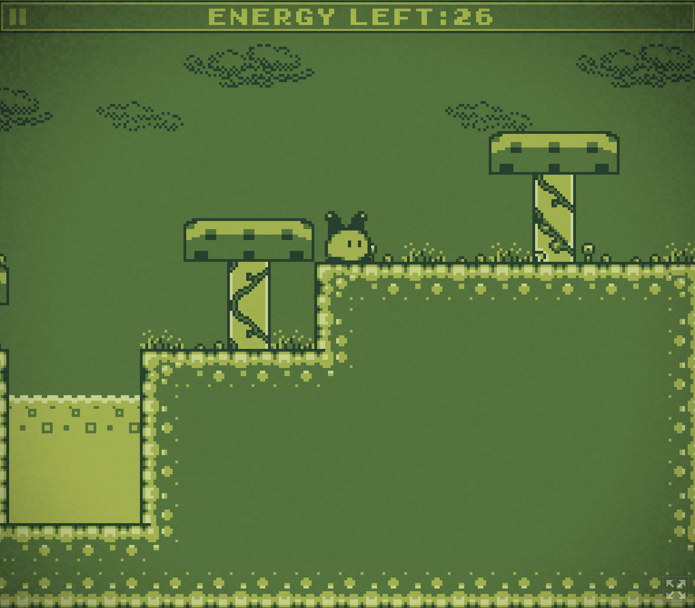
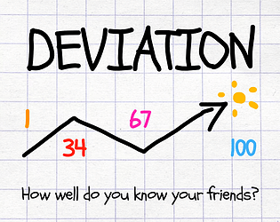
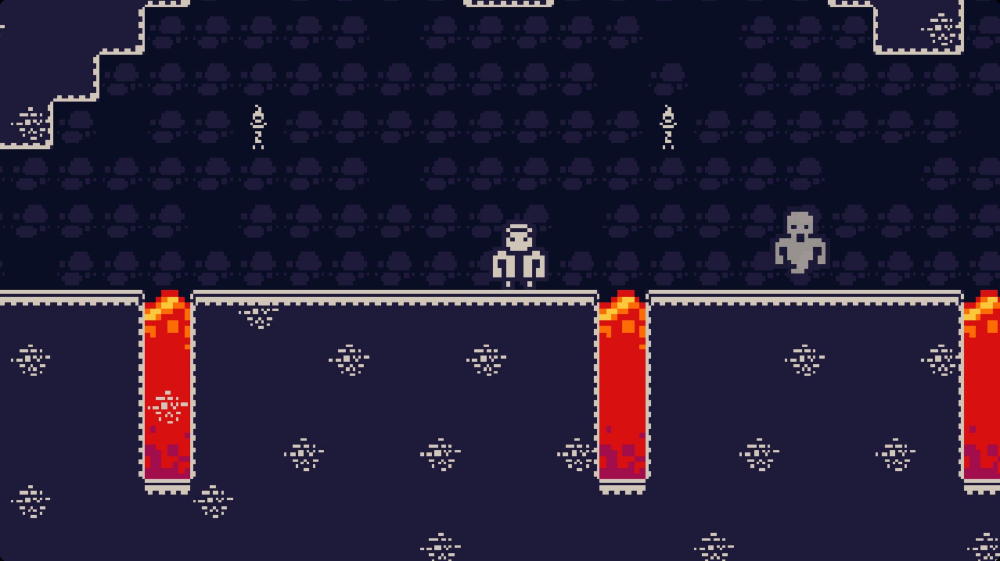
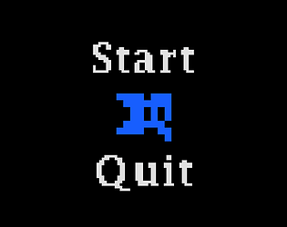
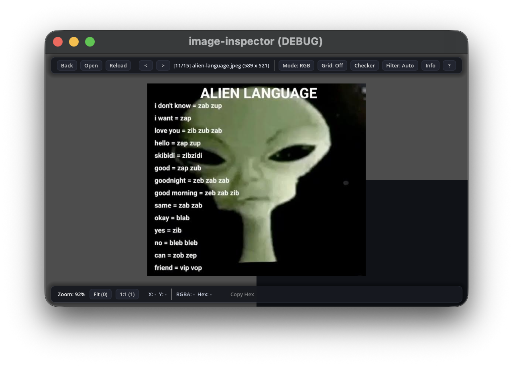
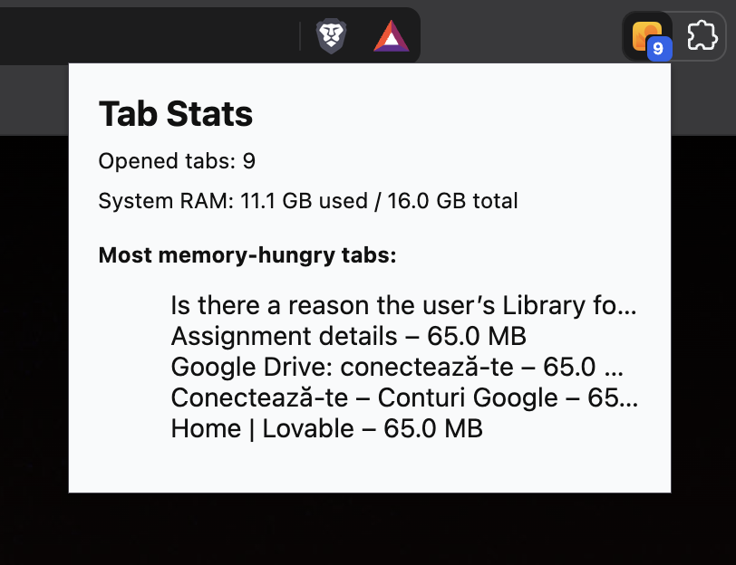

<div align="center">
  

  <a href="https://readme-typing-svg.demolab.com">
    
  </a>

  <p align="center">
    <a href="https://huppsy.itch.io/">
      
    </a>
  </p>
</div>

### 🚀 Despre Mine

```javascript
const daniel = {
  studii: "Calculatoare @ Universitatea „Ștefan cel Mare” Suceava",
  pasiune: ["Game Development", "Aplicații Desktop", "Web Dev"],
  filosofie: "Învățare prin proiecte practice și experimente"
};
```

---

### 🛠️ Tehnologii & Unelte

<p align="center">
  
</p>

---

### 🎮 Jocuri Video

> 🕹️ *Proiecte personale realizate în **Godot**, de la platformere 2D până la jocuri multiplayer și experimente 3D.*

<br/>

<!-- PROIECT JOC 1 -->
<details open>
<summary><b>🏆 I need energy!</b> — <i>Platformer Game Boy style (Locul II Game Jam)</i></summary>
<br/>

> **Descriere:** Platformer retro cu grafică inspirată de consola Game Boy. Proiect dezvoltat în timp limitat și premiat cu locul II la Game Jam-ul Trijam #199.

<a href="https://huppsy.itch.io/">
  
</a>

<br/><br/>

<!-- Înlocuiește URL-ul de mai jos cu o imagine / GIF din jocul tău -->


</details>

<br/>

<!-- PROIECT JOC 2 -->
<details open>
<summary><b>🎲 DEVIATION</b> — <i>Party game multiplayer local</i></summary>
<br/>

> **Descriere:** Joc de petrecere multiplayer local, în care jucătorii încearcă să ghicească media numerelor alese de grup.

<a href="https://huppsy.itch.io/">
  
</a>

<br/><br/>

<p align="center"></p>

</details>

<br/>

<!-- PROIECT JOC 3 -->
<details open>
<summary><b>🏃 Ghenstab</b> — <i>Platformer 2D alert</i></summary>
<br/>

> **Descriere:** Platformer 2D dinamic în care trebuie să sari peste inamici pentru a-i învinge și a avansa.

<a href="https://huppsy.itch.io/">
  
</a>

<br/><br/>

<p align="center"></p>

</details>

<br/>

<!-- PROIECT JOC 4 -->
<details open>
<summary><b>🕯️ Deceiving Darkness</b> — <i>Joc atmosferic Godot</i></summary>
<br/>

> **Descriere:** Un proiect atmosferic realizat în Godot, axat pe explorare și mecanici speciale de lumină/umbră.

<a href="https://huppsy.itch.io/">
  
</a>

<br/><br/>

<p align="center"></p>

</details>

---

### 💻 Aplicații & Utilitare

> 🛠️ *Instrumente create pentru rezolvarea de probleme practice și experimentare.*

<br/>

<!-- APLICAȚIE 1 -->
<details open>
<summary><b>🔍 Image Inspector</b> — <i>Inspector de imagini lightweight</i></summary>
<br/>

> **Descriere:** Utilitar lightweight creat în Godot 4 pentru vizualizarea rapidă și inspectarea detaliilor tehnice ale imaginilor.

<a href="https://github.com/kingptvoi">
  
</a>

<br/><br/>

<p align="center"></p>

</details>

<br/>

<!-- APLICAȚIE 2 -->
<details open>
<summary><b>🗂️ Tabs Opened</b> — <i>Extensie Chromium</i></summary>
<br/>

> **Descriere:** Extensie dedicată browsere-lor bazate pe Chromium pentru gestionarea și organizarea informațiilor despre taburile deschise.

<a href="https://github.com/kingptvoi">
  
</a>

<br/><br/>

<p align="center"></p>

</details>

<br/>

<!-- APLICAȚIE 3 & 4 (Grupate scurt) -->
<details>
<summary><b>🧮 Alte Proiecte Desktop (Calculator & Notes App)</b></summary>
<br/>

* **Calculator App:** Aplicație de calculator cu UI custom realizată în Godot.  
  [👉 Vezi Cod Sursă](https://github.com/kingptvoi)
* **Notes App:** Aplicație simplă și rapidă pentru crearea și gestionarea notițelor.  
  [👉 Vezi Cod Sursă](https://github.com/kingptvoi)

</details>

---

### 🚧 În Lucru (Work in Progress)

* 🚚 **Delivery to Nowhere** — *Joc horror 3D cu tematică de curierat*
* * 🚙 **Nu am nume inca** - *Joc 3D physics based*
* 🕹️ **PSX Memory Room** — *Proiect 3D inspirat din estetica era PlayStation 1*
* 🤖 **Robotics Club Website** — *Site de prezentare pentru clubul de robotică*

---

### 📊 Statistici GitHub

<div align="center">
  
  
</div>

<br/>

<div align="center">
  
</div>
